# Neovim JSTS Code Editor

Это пошаговая инструкция по сборке полноценного JavaScript/TypeScript Code Editor 
на базе Neovim и конфигурационного фреймворка NvChad.

Проект состоит из пяти основных этапов:

1. Установка и настройка NvChad
2. Установка инструментов разработчика (LSP, линтер, форматтер)
3. Установка дополнительных плагинов
4. Установка и настройка отладчика
5. Настройка pre-commit pipeline (ESLint + Prettier)

А также включает подборку полезных и функциональных плагинов для повседневной работы.

## Содержание

- [Часть 1: Установка и настройка NvChad](#часть-1-установка-и-настройка-nvchad)
    - [Установка NvChad](#установка-nvchad)
    - [Структура файлов NvChad](#структура-файлов-nvchad)
    - [Конфигурируем NvChad](#конфигурируем-nvchad)
- [Часть 2: Установка и настройка инструментов разработчика](#часть-2-установка-и-настройка-инструментов-разработчика)
    - [Treesitter](#treesitter)
    - [LSP-поддержка ts_ls + tsserver](#lsp-поддержка-ts_ls--tsserver)
    - [Tailwind CSS Language Server](#tailwind-css-language-server)
    - [ESLint](#eslint)
    - [Emmet](#emmet)
    - [Форматирование с Prettier](#форматирование-с-prettier)
- [Часть 3: Установка и настройка дополнительных инструментов](#часть-3-установка-и-настройка-дополнительных-инструментов)
    - [Список дополнительных плагинов](#список-дополнительных-инструментов)
    - [Установка](#установка-2)
- [Часть 4: Установка и настройка отладчика](#часть-4-установка-и-настройка-отладчика)
- [Часть 5: Настройка pre-commit pipeline](#часть-5-настройка-pre-commit-pipeline)
- [Часть 6: Пользовательские сниппеты](#часть-6-пользовательские-сниппеты)
- [Полезные плагины](#полезные-плагины)
- [Список использованных материалов](#список-использованных-материалов)
- [Приложение 1: Плагины NvChad по умолчанию](#приложение-1-плагины-nvchad-по-умолчанию)
- [Приложение 2: Как работает подсветка синтаксиса](#приложение-2-как-работает-подсветка-синтаксиса)
- [Приложение 3: Как работает LSP](#приложение-3-как-работает-lsp)
- [Приложение 4: Как работает LSP-поддержка JavaScript/TypeScript в Neovim](#приложение-4-как-работает-lsp-поддержка-javascript-typescript-в-neovim)
    - [Как это работает](#как-это-работает-2)
    - [Основные возможности предоставляемые ts_ls + tsserver](#основные-возможности-предоставляемые-ts_ls--tsserver)
- [Приложение 5: Как работает автодополнение](#приложение-5-как-работает-автодополнение)
- [Приложение 6: Как работает отладка](#приложение-6-как-работает-отладка)
- [Tips and tricks](#tips-and-tricks)

## Часть 1: Установка и настройка NvChad

Первичная установка NvChad происходит в соответствии с [официальной документацией](https://nvchad.com/docs/quickstart/install).

### Установка NvChad

Перед установкой необходимо удалить предыдущие конфигурации Neovim и убедиться в наличии следующих зависимостей:  

 - `Nerd Font` - требует в качестве шрифтов терминала.  
 - `Tree-sitter-cli` - требуется для установки парсеров nvim-treesitter.  
 - `Ripgrep` - для grep-поиска в Telescope.  
 - `GCC` - для сборки native-расширений.  

Установка выполняется одной командой:

```bash
git clone https://github.com/NvChad/starter ~/.config/nvim && nvim
```

### Структура файлов NvChad

После установки файлы NvChad будут распределены по нескольким директориям:  

| Директория | Назначение |
|---|---|
| `~/.config/nvim/` | Пользовательские конфигурации — основная рабочая директория |
| `~/.local/share/nvim/` | Установленные плагины (Lazy, Mason) |
| `~/.local/state/nvim/` | Файлы состояния: история, undo, swap, логи |

В рамках этого руководства мы будем работать только с файлами конфигурации, расположенными в `~/.config/nvim/`.

### Конфигурируем NvChad

Основной файл конфигурации: `~/.config/nvim/lua/chadrc.lua`  

Получить полную справку по его структуре:
```bash
:h nvui
```

В `chadrc.lua` конфигурируются:

- Цветовая схема (раздел base46)
- Элементы пользовательского интерфейса:
    - Стиль окна автодополнения
    - Стиль Telescope
    - Стиль statusline
    - Стиль tabufline
- Параметры плавающего терминала (раздел term)
- Приветственное окно (nvdash)
- Стиль cheatsheet
- Настройки `colorify.nvim` — отображение образцов цветов в буфере
- Пакеты Mason для автоматической установки

`hl_override и hl_add`  

Раздел `hl_override` в base46 полностью переопределяет стили для указанных `highlight-групп`.  
Раздел `hl_add` — дополняет существующие стили новыми, не заменяя их.  
Просмотреть доступные для переопределения группы можно командами:  
```bash
## список стандартных групп
:help highlight-groups
## текущие группы и их стили
:hi 
```

После внесения изменений в `chadrc.lua` выполнить для применения конфигурации:
```bash
:Lazy sync
:MasonInstallAll
```

## Часть 2: Установка и настройка инструментов разработчика

### Treesitter 

#### Для версии neovim 12+

Установить только необходимые парсеры:
```bash
TSInstall javascript typescript requirements regex lua luap luau html css json jsonc bash markdown markdown_inline yaml toml dockerfile git_config git_rebase gitattributes gitcommit gitignore
```

Установить все доступные парсеры:
```bash
TSInstallAll
```

#### Для версии neovim 11

Плагин nvim-treesitter перешёл на ветку main по умолчанию. 
Ветка main - это полный несовместимый рерайт nvim-treesitter, требующий neovim версии 12+ и использующий его новый API.  
Чтобы обеспечить работу nvim-treesitter с neovim 11 необходимо принудительно переключить ветку nvim-treesitter на master 
из которой доступна "старая" совместимая версия nvim-treesitter.  

Для этого в файле `plugins/init.lua` нужно прописать следующий конфиг:  
```lua
{
    "nvim-treesitter/nvim-treesitter",
    branch = "master",
    lazy = false,
    build = ":TSUpdate",
    config = function()
      require("nvim-treesitter.configs").setup({
        -- необходимые для установки плагины прописать здесь
        ensure_installed = { "html", "css", "bash", "javascript", "typescript", "requirements", "regex", "lua", "luap", "luau", "json", "jsonc", "markdown", "markdown_inline", "yaml", "toml", "dockerfile", "git_config", "git_rebase", "gitattributes", "gitcommit", "gitignore" },
        sync_install = true,
        highlight = { enable = true },
        indent = { enable = true },
      })
    end,
},

```

После перезапуска neovim указанные в ensure_installed парсеры будут установлены автоматически.  

### LSP-поддержка ts_ls + tsserver

`typescript-language-server`  

[typescript-language-server github page](https://github.com/typescript-language-server/typescript-language-server)

#### Как это работает

Подробнее о том, как именно работает LSP-поддержка `ts_ls + tsserver` можно узнать в  
[Приложение 4: Как работает LSP-поддержка JavaScript/TypeScript в Neovim](#как-работает-lsp-поддержка-javascript-typescript-в-neovim)

#### Установка

Добавить в `chadrc.lua`:

```lua
M.mason = {
  pkgs = {
    ...,
    "typescript-language-server"
}
...
```

Выполнить:
```
:MasonInstallAll
```

#### Активация и конфигурация

Добавить в `configs/lspconfig.lua`:
```lua
local servers = {
    ...
    ts_ls = {},
}
```

`ts_ls` обычно не требует дополнительной конфигурации и работает из коробки: автодополнение, переходы, диагностика, ссылки.  
Всё остальное настраивается в файлах проекта, а не в Neovim.  

`ts_ls` автоматически найдет эти файлы в корне проекта, если они существуют:  

- `jsconfig.json` - Файл конфигурации для JavaScript-проектов.  
- `tsconfig.json` - Файл конфигурации для TypeScript-проектов.  

В них можно определять:  

- Опции строгости проверки типов  
- Списки файлов и папок, которые `ts_ls` не должен анализировать  
- Настройки того, как `ts_ls` ищет модули и разрешает пути импортов  

#### Дополнительная справка

Справка nvim-lspconfig:
```
:help lspconfig 
:help lspconfig-all
```

### Tailwind CSS Language Server

`tailwindcss-language-server`  

[tailwindcss-language-server github page](https://github.com/tailwindlabs/tailwindcss-intellisense)

#### Как это работает

Tailwind language server определяет источник конфигурации в проекте, строит полный набор доступных классов и на этой
основе даёт автодополнение, hover-preview css, диагностику и подсказки.

В текущем Tailwind v4 источником конфигурации является css-файл, который содержит импорт `@import "tailwindcss"`.

#### Установка

Добавить в `chadrc.lua`:

```lua
M.mason = {
  pkgs = {
    ...,
    "tailwindcss-language-server"
}
...
```

Выполнить:
```
:MasonInstallAll
```

#### Активация и конфигурация

Добавить в `configs/lspconfig.lua`:
```lua
local servers = {
  ...
  tailwindcss = {},
}
```

При обычных обстоятельствах tailwindcss-language-server не нуждается в дополнительной конфигурации.  
Конфигурация может потребоваться только если:  

- Используются нестандартные расширения файлов  
- Tailwind не может найти входной CSS  
- Tailwind определяет не тот конфиг и его нужно переопределить  

### ESLint

Для отображения диагностики ESLint прямо в буфере Neovim требуются два основных компонента:  

- Плагин `nvim-lint`  
- Пакет `eslint_d`  

[nvim-lint](https://github.com/mfussenegger/nvim-lint) - Это асинхронный плагин линтинга для Neovim. Он дополняет встроенную поддержку LSP: 
запускает внешние линтеры и передаёт их результаты в стандартную систему диагностики Neovim (vim.diagnostic).

[eslint_d](https://github.com/mantoni/eslint_d.js/) - Это демон-обёртка, устанавливаемый через Mason. Он запускает eslint в фоновом процессе и переиспользует его между проверками.
Eslint_d может использовать как "собственный" eslint, который был установлен как его зависимость, так и локальный eslint, установленный в конкретном проекте. По умолчанию eslint_d
сначала ищет локальный eslint и если не находит, то использует "собственный".  
Рекомендуется использовать локальный eslint, так как версия "собственного" может отставать от актуальной.

#### Установка nvim-lint

В файл `plugins/init.lua` добавить следующий конфиг:  

```lua
{
  "mfussenegger/nvim-lint",
  event = { "BufReadPre", "BufNewFile" },
  config = function()
    local lint = require("lint")

    -- Привязываем жизненный цикл демона eslint_d к процессу Neovim.
    -- Когда Neovim закрывается, демон завершается вместе с ним,
    -- а не висит в фоне до истечения idle-таймаута.
    vim.env.ESLINT_D_PPID = vim.fn.getpid()

    -- Здесь укажем какой линтер для какого типа файлов запускать
    lint.linters_by_ft = {
      javascript = { "eslint_d" },
      typescript = { "eslint_d" },
      javascriptreact = { "eslint_d" },
      typescriptreact = { "eslint_d" },
    }

    local lint_augroup = vim.api.nvim_create_augroup("nvim_lint", { clear = true })

    -- Запуск линтера после сохранения файла.
    vim.api.nvim_create_autocmd({ "BufWritePost" }, {
      group = lint_augroup,
      callback = function()
        lint.try_lint()
      end,
    })
  end,
}
```

После перезапуска Neovim плагин будет установлен автоматически.

#### Установка eslint_d

Добавить в `chadrc.lua`:

```lua
M.mason = {
  pkgs = {
    ...,
    "eslint_d"
}
...
```

Выполнить:
```
:MasonInstallAll
```

### Emmet

Для полноценной работы с возможностями Emmet потребуются два основных компонента:

[emmet_language_server](https://github.com/olrtg/emmet-language-server) - это lsp-сервер, который предоставляет автодополнение сокращений (div>p, div*2, etc).  

[nvim-emmet](https://github.com/olrtg/nvim-emmet) - это плагин, который добавляет функцию "обернуть выделенный текст в тег", дополняя lsp-сервер. 

#### Установка emmet_language_server

Устанавливается через Mason.  

Добавить в `chadrc.lua`:

```lua
M.mason = {
  pkgs = {
    ...,
    "emmet-language-server"
}
...
```

Выполнить:
```
:MasonInstallAll
```

#### Установка nvim-emmet

В файл `plugins/init.lua` добавить следующий конфиг:  

```lua
{
    "olrtg/nvim-emmet",
    enabled = true,
    ft = {
      "html",
      "javascript",
      "javascriptreact",
      "typescript",
      "typescriptreact",
    },
    config = function()
      vim.keymap.set({ "n", "v" }, '<leader>me', require('nvim-emmet').wrap_with_abbreviation)
    end
},
```

После перезапуска neovim плагин будет установлен автоматически.

### Форматирование с Prettier

Для форматирования кода потребуются три основных компонента:  

1. Prettier
2. Conform
3. Конфигурационный файл для Prettier

[Prettier](https://prettier.io) - Это внешний инструмент для форматирования кода, который подключается через плагины-мосты и приводит код к единому стилю по заданным правилам.  

[Conform](https://github.com/stevearc/conform.nvim) - Это плагин для управления внешними инструментами форматирования - как раз тот самый плагин-мост, который будет управлять Prettier.  

#### Установка Prettier

Устанавливается через Mason.

Добавить в `chadrc.lua`:

```lua
M.mason = {
  pkgs = {
    ...,
    "prettier"
}
...
```

Выполнить:
```
:MasonInstallAll
```

#### Настройка Conform

`Conform` предустановлен в NvChad.  
Для того, чтобы он использовал Prettier для форматирования JavaScript и TypeScript файлов в `configs/conform.lua` необходимо добавить следующее:  

```lua
local options = {
  formatters_by_ft = {
    ...
    javascript = { "prettier" },
    javascriptreact = { "prettier" },
    typescript = { "prettier" },
    typescriptreact = { "prettier" },
  },
 ...
}
```

#### Конфигурационный файл для Prettier

Prettier принимает конфигурацию из файла .prettierrc (или .prettierrc.json) в корне проекта.  
  
Пример конфигурации:  
```json
{
  "semi": true,
  "trailingComma": "es5",
  "singleQuote": true,
  "printWidth": 80,
  "tabWidth": 2,
  "useTabs": false
}
```

## Часть 3: Установка и настройка дополнительных инструментов

### Список дополнительных инструментов

`json-lsp`

Это LSP-сервер для JSON в Neovim, который обеспечивает автодополнение, проверку синтаксиса и валидацию по схеме .

[json-lsp github page](https://github.com/microsoft/vscode-json-languageservice)

`taplo`  

Инструмент для комфортной работы с `*.toml` файлами.  
Работает как lsp-сервер, предоставляет: автодополнение, диагностику ошибок, навигацию, форматирование, валидацию toml по json schema.  

[taplo github page](https://github.com/tamasfe/taplo)

`yaml language server`

Инструмент для комфортной работы с `*.yaml` файлами.  
Работает как lsp-сервер, предоставляет: автодополнение, диагностику ошибок, hover-информацию, навигацию, форматирование, валидацию схем.  

[yaml-language-server github page](https://github.com/redhat-developer/yaml-language-server)

`docker language server`

Инструмент от Docker для работы с Dockerfile и Bake.  
Работает как lsp-сервер, предоставляет: автодополнение, диагностику ошибок, навигацию, форматирование и hover-информацию.  
Поддерживает линтинг для Dockerfile.  

[docker-language-server github page](https://github.com/docker/docker-language-server)

`dockerfmt`

Форматтер для Dockerfile.  
Он автоматически приводит Dockerfile к единому стилю: форматирует директивы, нормализует пробелы и форматирует shell-команды.  
Умеет преобразовывать устаревший синтаксис ENV.

[dockerfmt github page](https://github.com/reteps/dockerfmt)

### Установка

Добавить в `chadrc.lua`:  
```lua
-- mason
...
M.mason = {
  pkgs = {
      ...
    "json-lsp",
    "taplo",
    "yaml-language-server",
    "docker-language-server",
    "dockerfmt",
  }
```

Добавить в `configs/lspconfig.lua`:
```lua
require("nvchad.configs.lspconfig").defaults()

local servers = {
    ...
  jsonls = {},
  yamlls = {
    filetypes = { "yaml", "yaml.docker-compose" },
  },
  taplo = {},
  docker_language_server = {},
}
...
```

Добавить в `configs/conform.lua`:
```lua
local options = {
    ...
    dockerfile = { "dockerfmt" },
}
```

Выполнить:  
```bash
:MasonInstallAll
```

## Часть 4: Установка и настройка отладчика

Для отладки JavaScript и TypeScript кода в Neovim будем использовать js-debug-adapter.  
Это официальный и самый продвинутый отладчик от Microsoft (тот же самый, что используется по умолчанию в VSCode).  
Он поддерживает отладку как серверного кода (Node.js), так и фронтенда (в связке с браузером), а также отлично работает с TypeScript без предварительной ручной компиляции.

Для работы отладки JavaScript / TypeScript кода в Neovim требуются два основных компонента:
- nvim-dap с дополнительными зависимостями
- js-debug-adapter

`nvim-dap`
Это DAP-клиент, устанавливаемый как Neovim плагин через Lazy. 
Сам nvim-dap это не отладчик, а "оператор", который управляет сторонними отладчиками (адаптерами) используя протокол DAP и передаёт Neovim данные для отображения (брейкпоинты, стек, переменные, etc). 
Отображением информации занимаются встроенные механизмы Neovim и UI-плагины, устанавливаемые в качестве зависимостей (см. Дополнительные зависимости).

`js-debug-adapter` 
Это официальный и самый продвинутый отладчик (адаптер) от Microsoft. Она устанавливается через Mason и управляет реальным отладчиком. 
Сам отладчик это встроенный в NodeJS V8 Inspector - отладочный движок, который предоставляет CDP (Chrome DevTools Protocol). 
Адаптер js-debug-adapter переводит DAP <-> CDP.

js-debug-adapter поддерживает два сценария отладки:  
- Отладка серверного кода (Node.js/SSR)  
- Отладка клиентского кода (который работает в браузере)  
Для каждого сценария необходимо создать собственную конфигурацию.  

### Установка js-debug-adapter

Устанавливается через Mason.  

Добавить в `chadrc.lua`:

```lua
M.mason = {
  pkgs = {
    ...,
    "js-debug-adapter"
}
...
```

Выполнить:
```
:MasonInstallAll
```

### Установка и конфигурация nvim-dap

Для комфортной работы с nvim-dap в Neovim потребуется установить nvim-dap со следующими зависимостями:  

`nvim-dap-ui`  
Графический интерфейс для nvim-dap: панели со стеком вызовов, переменными, точками останова, консолью (REPL) и т.д.  

`nvim-dap-virtual-text`  
Показывает значения переменных прямо рядом с кодом, используя тот же механизм virtual text (extmarks), что и подсказки LSP-сервера.  

`nvim-nio`
Библиотека для асинхронного ввода-вывода, зависимость nvim-dap-ui.

Сначала создадим файл конфигурации для nvim-dap, в котором настроим используемые горячие клавиши.  

`plugins/nvim-dap/nvim-dap-keys.lua`:  

```lua
local M = {}

M.keys = {
    -- Установить условный breakpoint (с выражением)
    { "<leader>dB", function() require("dap").set_breakpoint(vim.fn.input('Breakpoint condition: ')) end, desc = "Breakpoint Condition" },
    -- Включить / выключить обычный breakpoint
    { "<leader>db", function() require("dap").toggle_breakpoint() end, desc = "Toggle Breakpoint" },
    -- Запустить или продолжить выполнение программы
    { "<leader>dc", function() require("dap").continue() end, desc = "Run/Continue" },
    -- Запустить с аргументами (пользовательская функция `get_args` должна быть определена где-то в конфиге)
    -- { "<leader>da", function() require("dap").continue({ before = get_args }) end, desc = "Run with Args" },
    -- Запустить до курсора
    { "<leader>dC", function() require("dap").run_to_cursor() end, desc = "Run to Cursor" },
    -- Перейти к строке (без выполнения)
    { "<leader>dg", function() require("dap").goto_() end, desc = "Go to Line (No Execute)" },
    -- Шаг внутрь (step into)
    { "<leader>di", function() require("dap").step_into() end, desc = "Step Into" },
    -- Переместиться вниз по call stack
    { "<leader>dj", function() require("dap").down() end, desc = "Down" },
    -- Переместиться вверх по call stack
    { "<leader>dk", function() require("dap").up() end, desc = "Up" },
    -- Запустить последний запуск
    { "<leader>dl", function() require("dap").run_last() end, desc = "Run Last" },
    -- Шаг наружу (step out)
    { "<leader>do", function() require("dap").step_out() end, desc = "Step Out" },
    -- Шаг через (step over)
    { "<leader>dO", function() require("dap").step_over() end, desc = "Step Over" },
    -- Поставить выполнение на паузу
    { "<leader>dP", function() require("dap").pause() end, desc = "Pause" },
    -- Включить/выключить REPL (интерактивная консоль)
    { "<leader>dr", function() require("dap").repl.toggle() end, desc = "Toggle REPL" },
    -- Показать информацию о текущей отладочной сессии
    { "<leader>ds", function() require("dap").session() end, desc = "Session" },
    -- Завершить отладочную сессию
    { "<leader>dt", function() require("dap").terminate() end, desc = "Terminate" },
    -- Открыть всплывающее окно с информацией (переменные и т.п.)
    { "<leader>dw", function() require("dap.ui.widgets").hover() end, desc = "Widgets" },
}

return M
```

Создадим файл конфигурации для nvim-dap-ui.

`plugins/nvim-dap-ui/nvim-dap-ui-config.lua`:

```lua
local m = {}

function m.setup(opts)
    local dap = require("dap")

    -- подключаем и настраиваем nvim-dap-ui с переданными опциями (opts из lazy plugin config).
    local dapui = require("dapui")
    dapui.setup(opts)
    
    -- автоматически открываем ui, когда начинается сессия отладки (event_initialized).
    dap.listeners.after.event_initialized["dapui_config"] = function()
        dapui.open({})
    end
    dap.listeners.before.event_terminated["dapui_config"] = function()
        dapui.close({})
    end
    -- закрывает ui, когда отладка завершена (event_terminated) или пользователь вышел (event_exited).
    dap.listeners.before.event_exited["dapui_config"] = function()
        dapui.close({})
    end

    -- стиль точки останова
    -- определение знака для точки останова
    vim.fn.sign_define('DapBreakpoint', {text='⬤', texthl='DapBreakpoint', linehl='', numhl=''})
    -- определение цветовой группы для точки останова
    vim.cmd('highlight DapBreakpoint guifg=#ff0000 ctermfg=red')
end

return m
```

Теперь создадим файл конфигурации для nvim-dap-ui, в котором настроим используемые горячие клавиши.

`plugins/nvim-dap-ui/nvim-dap-ui-keys.lua`:  

```lua
local M = {}

M.keys = {
    -- открыть/закрыть интерфейс отладки (панели переменных, стек вызовов и т.д.)
    { "<leader>du", function() require("dapui").toggle({ }) end, desc = "Dap UI" },
    -- выполнить команду "eval" (вывод значения переменной под курсором)
    { "<leader>de", function() require("dapui").eval() end, desc = "Eval", mode = {"n", "v"} },
}

return M
```

Чтобы установить nvim-dap со всеми зависимостями добавим в `plugins/init.lua`:

```lua
{
    "mfussenegger/nvim-dap",
    ft = { "javascript", "typescript", "javascriptreact", "typescriptreact" },
    dependencies = {

      -- плагин для и его конфигурации
      {
        "rcarriga/nvim-dap-ui",
        opts = {},
        -- [конфигурация nvim-dap-ui]: горячие клавиши для nvim-dap-ui
        keys = require("plugins.nvim-dap.nvim-dap-ui.nvim-dap-ui-keys").keys,
        dependencies = { "nvim-neotest/nvim-nio" },
        config = function (_, opts)
          -- [конфигурация nvim-dap-ui]: 
          require("plugins.nvim-dap.nvim-dap-ui.nvim-dap-ui-config").setup(opts)
        end,
      },
      -- плагин для отображения значения переменных прямо в коде
      {
        "theHamsta/nvim-dap-virtual-text",
        opts = {},
      },
    },

    -- [конфигурация nvim-dap]: hotkeys для управления отладкой 
    keys = require("plugins.nvim-dap.nvim-dap-keys").keys,

    -- [конфигурация nvim-dap]
    config = function ()
      -- подсветка строки, где выполнение остановилось
      vim.api.nvim_set_hl(0, "DapStoppedLine", { default = true, link = "Visual" })
      -- setup dap config by VsCode launch.json file
      local vscode = require("dap.ext.vscode")
      local json = require("plenary.json")
      -- DAP читает launch.json с помощью plenary
      vscode.json_decode = function(str)
        return vim.json.decode(json.json_strip_comments(str))
      end

    end,
},
```

### Конфигурация для отладки серверного кода

Мы будем конфигурировать nvim-dap вручную.  

Основным шагом в процессе конфигурации является указание пути к исполняемому файлу js-debug-adapter. 
Согласно официальной документации js-debug-adapter содержит два исполняемых файла:
- dapDebugServer.js - этот файл используется для работы с Neovim  
- vsDebugServer.js - используется только с VSCode.  

Мы вынесем конфигурацию в файл `plugins/nvim-dap/nvim-dap-jsdebug.lua` и в дальнешем покдлючим его к nvim-dap в `plugins/init.lua`.  

Конфигурация `nvim-dap-jsdebug.lua`:  

```lua
local dap = require("dap")

-- 1. Регистрируем адаптер с именем "pwa-node" в таблице адаптеров nvim-dap
dap.adapters["pwa-node"] = {
    -- Тип подключения: nvim-dap будет запускать адаптер как сервер и подключаться к нему
    type = "server",
    -- Хост, на котором слушает сервер адаптера
    host = "::1",                       
    -- Порт: "${port}" означает, что nvim-dap сам выберет свободный порт и подставит его
    port = "${port}",                         
    -- Описание исполняемого файла, который нужно запустить
    executable = {
        -- Команда для запуска: интерпретатор Node.js (адаптер написан на JS)
        command = "node",                     
        -- Аргументы: путь к dapDebugServer.js и тот же порт
        args = {
            vim.fn.stdpath("data") .. "/mason/packages/js-debug-adapter/js-debug/src/dapDebugServer.js",
            "${port}"
        },
    }
}

-- 2. Конфигурации запуска для JS/TS
dap.configurations.javascript = {
    {
        type = "pwa-node",
        request = "launch",
        name = "Launch current file",
        program = "${file}",
        cwd = "${workspaceFolder}",
        console = "integratedTerminal",
    },
}

-- Дублируем те же конфигурации для TypeScript и React
dap.configurations.typescript = dap.configurations.javascript
dap.configurations.javascriptreact = dap.configurations.javascript
dap.configurations.typescriptreact = dap.configurations.javascript
```

Для подключения файла добавим cоответсвующую строку в файл `plugins/init.lua`:

```lua
{
    "mfussenegger/nvim-dap",


    -- [Текущий конфиг]
    ...


    -- [конфигурация nvim-dap]
    config = function ()
      -- подсветка строки, где выполнение остановилось
      vim.api.nvim_set_hl(0, "DapStoppedLine", { default = true, link = "Visual" })
      -- setup dap config by VsCode launch.json file
      local vscode = require("dap.ext.vscode")
      local json = require("plenary.json")
      -- DAP читает launch.json с помощью plenary
      vscode.json_decode = function(str)
        return vim.json.decode(json.json_strip_comments(str))
      end

      -- <НОВАЯ СТРОКА> ЗДЕСЬ ПОДКЛЮЧАЕМ ФАЙЛ КОНФИГУРАЦИИ
      -- [конфигурация nvim-dap]: подключаем конфигурацию для JS/TS (js-debug-adapter)
      require("plugins.nvim-dap.nvim-dap-jsdebug")
    end,
},
```


## Часть 5: Настройка pre-commit pipeline

## Часть 6: Пользовательские сниппеты

Разберём на следующем примере:  
Для удобства вёрстки я хочу иметь возможность в любой момент развернуть шаблон Tailwind-классов.  
Шаблон выглядит так:  

```javascriptreact
className={cn(
  // layout
  "", // general
  "", // breakpoints

  // size
  "",
  "",

  // spacing
  "",
  "",

  // typography
  "",
  "",

  // borders / effects
  "",
  "",
)}
```

NvChad поставляется с предустановленным плагином LuaSnip - движком сниппетов, который позволяет вставлять заготовленные куски кода по короткому триггеру. 
LuaSnip умеет получать сниппеты из разных источников: в NvChad, например, из коробки предустановлена коллекция friendly-snippets, с которой движок работает по умолчанию. 
При этом LuaSnip умеет работать и с кастомными (пользовательскими) сниппетами, что в ряде случаев очень удобно.

Добавление пользовательских сниппетов делается в два шага:  

1. Настройка LuaSnip
2. Создание сниппетов

### Настройка LuaSnip

Создать в `~/.config/nvim/lua/` директорию `snippets` - здесь будут храниться пользовательские сниппеты.  

После этого необходимо добавить этот путь в конфигурацию LuaSnip. Для этого в файл `plugins/init.lua` необходимо добавить:  

```lua
{
"L3MON4D3/LuaSnip",
config = function(_, opts)
  require("luasnip").config.set_config(opts)
  require("nvchad.configs.luasnip")

  require("luasnip.loaders.from_lua").load({
    paths = { vim.fn.stdpath("config") .. "/lua/snippets" }
  })
end,
},
```

### Создание сниппетов

Чтобы LuaSnip корректно ассоциировал определённые наборы сниппетов с определёнными filetypes (например, не предлагал Python-сниппеты в JavaScript-коде), 
согласно спецификации LuaSnip файлы пользовательских сниппетов в директории `~/.config/nvim/lua/snippets/` нужно называть по имени filetype.

В этом примере мы рассматриваем сниппеты для React-проектов на JavaScript, поэтому файл нужно назвать `javascriptreact.lua`.  

В него нужно добавить следующий код:  

```lua
local ls = require("luasnip")
local s = ls.snippet
local fmt = require("luasnip.extras.fmt").fmt
local i = ls.insert_node

return {
  s({ trig = "cntw", dscr = "My custom tailwind cn template" },
    fmt([[
      className={{cn(
        // layout
        "",
        "",

        // size
        "",
        "",

        // spacing
        "",
        "",

        // typography
        "",
        "",

        // borders / effects
        "",
        "",
      )}}]],
    { i(1, "general") }, { strict = false }
  )),
}
```

Далее, перезапустить Neovim.

Теперь сниппет будет доступен по триггеру `cntw` в меню автодополнения.

## Полезные плагины

### AI-ассистент

`yetone/avante.nvim`

[avante github page](https://github.com/yetone/avante.nvim)

### Навигация и редактирование

`folke/flash.nvim`

Быстрые прыжки по тексту.  
Улучшенные motions f/t.  

[flash github page](https://github.com/folke/flash.nvim)

`kevinhwang91/nvim-ufo`

Улучшает встроенный folding.  

[neovim ufo github page](https://github.com/kevinhwang91/nvim-ufo)

`mg979/vim-visual-multi`

Полноценное multi-cursor редактирование.  
Одновременная работа с несколькими курсорами и выделениями.  

[vim-visual-multi github page](https://github.com/mg979/vim-visual-multi)

`hinell/duplicate.nvim`

Удобное дублирование строк и выделенных блоков.  

[duplicate github page](https://github.com/hinell/duplicate.nvim)

`fedepujol/move.nvim`

Перемещение строк и блоков с возможностью сохранения индентации.

[move github page](https://github.com/fedepujol/move.nvim)

### Уведомления и интерфейс

`folke/noice.nvim`

Заменяет стандартный UI для сообщений, командной строки и popup-меню:  

- Отображает уведомления с помощью notify.nvim  
- Позволяет гибко маршрутизировать сообщения от neovim и отображать их в разных представлениях  
- Ведёт историю сообщений  
- Добавляет UI для Command line  
- Добавляет UI для поиска  
- Добавляет UI для Hover-документации от LSP  
- Добавляет UI для LSP signature help  
- Подсвечивает синтаксис Vim/Lua прямо в Commad line  
- Отображает длинный вывод команд в обычных буферах/split  
- Подсвечивает синтаксис Vim/Lua прямо в Command line  

[noice github page](https://github.com/folke/noice.nvim)

`lukas-reineke/indent-blankline.nvim`

Подсветка направляющих отступов и вложенности.  
Улучшает читаемость кода.

[indent-blankline github page](https://github.com/lukas-reineke/indent-blankline.nvim)

`HiPhish/rainbow-delimiters.nvim`

Подсвечивает вложенные разделители, теги и ключевые слова разными цветами.  
Улучшает читаемость кода (особенно html и jsx).  

[rainbow-delimiters github page](https://github.com/hiphish/rainbow-delimiters.nvim)

`folke/todo-comments.nvim`

Подсвечивает теги комментариев (FIX, TODO, NOTE, PERF, HACK, WARNING).
Улучшает читаемость кода.

[todo-comments github page](https://github.com/folke/todo-comments.nvim)

`karb94/neoscroll`

Добавляет плавную анимацию прокрутки в Neovim вместо резких скачков при перемещении по файлу.  

[neoscroll github page](https://github.com/karb94/neoscroll.nvim)

`sphamba/smear-cursor.nvim`

Дополнительная анимация для курсора.  
Позволяет лучше замечать перемещения курсора.  

[smear-cursor github page](https://github.com/sphamba/smear-cursor.nvim)

`MeanderingProgrammer/render-markdown.nvim`

Рендеринг Markdown прямо в буфере Neovim.  

[render-markdown github page](https://github.com/MeanderingProgrammer/render-markdown.nvim)

### lsp интеграция

`nvimdev/lspsaga.nvim`

Улучшает встроенный LSP-интерфейс Neovim, предоставляя более удобный UI для навигации, диагностики, code actions и работы с символами:

- Показывает диагностику LSP в удобных float-окнах и позволяет быстро переходить между ошибками  
- Даёт Finder для поиска определений, ссылок и других LSP-символов  
- Добавляет Peek Definition / Peek Type Definition — просмотр определения прямо во всплывающем окне  
- Улучшает Hover — отображение документации и информации о символе  
- Добавляет удобный Rename с предварительным просмотром изменений и поиском/заменой по проекту  
- Показывает Code Actions в отдельном UI с live preview  
- Показывает Lightbulb при наличии доступных Code Actions  
- Добавляет Call Hierarchy — поиск входящих и исходящих вызовов  
- Показывает реализации интерфейсов и позволяет быстро переходить к ним  
- Добавляет Outline — дерево символов текущего файла  
- Добавляет Breadcrumbs — текущий путь по символам в winbar  
- Улучшает переходы Go to Definition / Type Definition визуальным beacon-индикатором  
- Добавляет float terminal  
- Предоставляет единый настраиваемый UI для LSP float-окон, границ, иконок и preview  

[lspsaga github page](https://github.com/nvimdev/lspsaga.nvim)

`folke/trouble.nvim`

Предоставляет единый удобный UI для диагностики и результатов LSP, Quickfix и Location List.  
Удобно для копирования сообщений lsp и линтера.

[trouble github page](https://github.com/folke/trouble.nvim)

### git интеграция

Git-клиент внутри Neovim

`NeogitOrg/neogit`

[neogit github page](https://github.com/NeogitOrg/neogit)

## Список использованных материалов

neovim: [neovim official website](https://neovim.io/)  
neovim: [neovim github page](https://github.com/neovim/neovim)  
  
nvchad: [nvchad official website](https://nvchad.com/)  
nvchad: [nvchad github page](https://github.com/NvChad/NvChad)  

dotfyle - discover neovim plugins: [dotfyle](https://dotfyle.com/)  

lazy: [lazy plugin manager docs](https://lazy.folke.io/)  
lazyvim: [lazyvim setup docs](https://www.lazyvim.org/)  

debug adapter docs: [nvim-dap javascript documentation](https://codeberg.org/mfussenegger/nvim-dap/wiki/Debug-Adapter-installation#javascript)  
debugging guide: [guide to debugging in neovim](https://tamerlan.dev/a-guide-to-debugging-applications-in-neovim/)   
lazyvim dap spec: [lazyvim dap core specification](https://www.lazyvim.org/extras/dap/core)  

документация tsconfig.json: [typescript-lang docs](https://www.typescriptlang.org/docs/handbook/tsconfig-json.html)

## Приложение 1: Плагины NvChad по умолчанию

### Плагины NvChad

Базовые плагины фреймворка NvChad, обеспечивающие его работу, темы и пользовательские меню.


| Плагин | Описание | Ссылка |
|--------|----------|--------|
| nvchad/base46 | Движок тем NvChad: управление цветовыми схемами, переопределение highlight-групп, интеграции с плагинами | https://github.com/NvChad/base46 |
| nvchad/ui | UI-слой NvChad: statusline, tabufline (вкладки + буферы), cheatsheet, theme switcher, updater | https://github.com/NvChad/ui |
| nvzone/menu | Библиотека для создания всплывающих меню (используется minty и другими nvzone-плагинами) | https://github.com/nvzone/menu |
| nvzone/volt | Фреймворк для создания реактивных UI-компонентов внутри Neovim | https://github.com/nvzone/volt |
| nvzone/minty | Инструменты подбора и манипуляции цветом: команды Huefy и Shades | https://github.com/nvzone/minty |


### Плагины для автодополнения

Система автодополнения (completion) и всё, что с ней связано: движок сниппетов, источники, авто-закрытие скобок.


| Плагин | Описание | Ссылка |
|--------|----------|--------|
| hrsh7th/nvim-cmp | Основной фреймворк автодополнения (completion engine) | https://github.com/hrsh7th/nvim-cmp |
| L3MON4D3/LuaSnip | Движок сниппетов с поддержкой сложных преобразований | https://github.com/L3MON4D3/LuaSnip |
| rafamadriz/friendly-snippets | Коллекция готовых сниппетов для множества языков и фреймворков | https://github.com/rafamadriz/friendly-snippets |
| windwp/nvim-autopairs | Автоматическое закрытие скобок, кавычек и других парных символов | https://github.com/windwp/nvim-autopairs |
| saadparwaiz1/cmp_luasnip | Источник сниппетов LuaSnip для nvim-cmp | https://github.com/saadparwaiz1/cmp_luasnip |
| hrsh7th/cmp-nvim-lua | Источник API Neovim Lua для nvim-cmp | https://github.com/hrsh7th/cmp-nvim-lua |
| hrsh7th/cmp-nvim-lsp | Источник LSP-завершений для nvim-cmp | https://github.com/hrsh7th/cmp-nvim-lsp |
| hrsh7th/cmp-buffer | Источник завершений из содержимого открытых буферов для nvim-cmp | https://github.com/hrsh7th/cmp-buffer |
| FelipeLema/cmp-async-path | Источник путей файловой системы для nvim-cmp | https://codeberg.org/FelipeLema/cmp-async-path |


### User Interface плагины

Плагины, отвечающие за визуальное оформление, навигацию и отображение информации.


| Плагин | Описание | Ссылка |
|--------|----------|--------|
| nvim-tree/nvim-web-devicons | Набор иконок для типов файлов (используется nvim-tree, telescope и др.) | https://github.com/nvim-tree/nvim-web-devicons |
| nvim-tree/nvim-tree.lua | Файловый менеджер в виде дерева директорий | https://github.com/nvim-tree/nvim-tree.lua |
| folke/which-key.nvim | Всплывающая подсказка по доступным хоткеям при нажатии лидера | https://github.com/folke/which-key.nvim |
| lukas-reineke/indent-blankline.nvim | Вертикальные линии отступов (indent guides) и подсветка scope-блоков | https://github.com/lukas-reineke/indent-blankline.nvim |


### Инструменты 

Инструменты для разработки: LSP, форматирование, подсветка синтаксиса.


| Плагин | Описание | Ссылка |
|--------|----------|--------|
| mason-org/mason.nvim | Менеджер внешних инструментов: LSP-серверы, DAP-адаптеры, линтеры, форматтеры | https://github.com/mason-org/mason.nvim |
| neovim/nvim-lspconfig | Стандартная конфигурация LSP-серверов для Neovim | https://github.com/neovim/nvim-lspconfig |
| stevearc/conform.nvim | Форматирование кода с поддержкой множества форматтеров и LSP-fallback | https://github.com/stevearc/conform.nvim |
| nvim-treesitter/nvim-treesitter | Синтаксический парсер: улучшенная подсветка, навигация по AST, инкрементальный выбор | https://github.com/nvim-treesitter/nvim-treesitter |


### Другое 

Плагины общего назначения, не вошедшие в предыдущие категории.


| Плагин | Описание | Ссылка |
|--------|----------|--------|
| nvim-lua/plenary.nvim | Набор Lua-утилит (JSON, Path, async-операции, job control) — зависимость многих плагинов | https://github.com/nvim-lua/plenary.nvim |
| nvim-telescope/telescope.nvim | Универсальный fuzzy-поиск: файлы, grep, diagnostics, git, LSP и сотни расширений | https://github.com/nvim-telescope/telescope.nvim |
| lewis6991/gitsigns.nvim | Git-значки в gutter-колонке: добавлено, изменено, удалено, blame, hunk-навигация | https://github.com/lewis6991/gitsigns.nvim |


## Приложение 2: Как работает подсветка синтаксиса

В современных версиях neovim движок tree-sitter встроен в neovim.  
Плагин `nvim-treesitter.nvim` - это надстройка, которая устанавливает парсеры и поставляет файлы запросов.  
Саму подсветку выполняет встроенный движок tree-sitter.  

Работает примерно так:

1. Определение filetype (*.py, *.html, etc).  
2. Включение подсветки (включается tree-sitter подсветка для буфера).  
3. Поиск парсера (neovim проверяет установлен ли для этого языка парсер).  
4. Построение дерева (если парсер найден, движок tree-sitter строит AST - синтаксическое дерево).  
5. Применение запросов (подбирается файл запроса: такой файл описывает, каким узлам дерева какая синтаксическая роль соответствует. движок tree-sitter помечает узлы специальными именами).  
6. Раскраска (эти имена и есть группы подвестки highlight groups. neovim берёт для них цвета, заданные текущей цветовой схемой).  

## Приложение 3: Как работает LSP

Language Server Protocol (LSP) — это протокол обмена данными между LSP-клиентом и LSP-сервером.  

LSP-клиент встроен в сам Neovim. LSP-серверы, специфичные для каждого языка программирования или разметки, устанавливаются отдельно — в нашем случае через Mason.  

LSP-сервер может поддерживать автодополнение кода, диагностику, переход к определению (go to definition), подсветку семантических элементов и другие возможности. Функциональность у разных LSP-серверов разная: один сервер может уметь всё перечисленное, другой — только часть.  

Встроенному LSP-клиенту для запуска конкретного сервера нужна конфигурация: как его запустить, в какой директории проекта работать, какие настройки ему передать.  
Писать это вручную для каждого сервера неудобно, поэтому используется плагин nvim-lspconfig — он не запускает серверы сам, а просто хранит готовые конфигурации для множества известных LSP-серверов и документацию по ним.  
Neovim использует эти конфигурации, а запускает и поддерживает соединение с сервером уже сам, силами встроенного LSP-клиента.



## Приложение 4: Как работает LSP-поддержка JavaScript / TypeScript в Neovim

### Как это работает

В процессе участвуют две основные сущности:

`tsserver` - Это движок со своим собственным протоколом из пакета typescript, который изначально создавался для VSCode.
Содержит компилятор и всю языковую логику: разбор кода, проверку типов, автодополнение, поиск определений, рефакторинги.  
Mason установит пакет typescript по умолчанию при установке ts_ls (как зависимость ts_ls).  
Посмотреть можно здесь: `~/.local/share/nvim/mason/packages/typescript-language-server/node_modules/`.
Поэтому локальная установка typescript в проект (например, при работе с чистым JS) не требуется.  

`ts_ls` - Это LSP-обертка над tsserver. Принимает запросы от LSP-клиента Noevim, переводит их в формат tsserver, получает ответ и возвращает его обратно в LSP-клиент.  
Он сам ничего не анализирует - только проксирует.

Один и тот же ts_ls + tsserver обслуживает: javascript, javascriptreact, typescript, typescriptreact.

### Основные возможности предоставляемые ts_ls + tsserver

**Навигация и понимание кода:**

- Переход к определению (textDocument/definition)

- Поиск ссылок (textDocument/references)

- Навигация по символам документа (textDocument/documentSymbol)

- Поиск символов в рабочей области (workspace/symbol)

- Подсветка вхождений (textDocument/documentHighlight)

- Иерархия вызовов (callHierarchy)

**Автодополнение и подсказки:**

- Автодополнение кода (textDocument/completion с resolve)

- Подсказки при наведении (textDocument/hover)

- Помощь по сигнатурам функций (textDocument/signatureHelp)

- Inlay hints — встроенные аннотации типов и имён параметров (textDocument/inlayHint)

**Редактирование и рефакторинг:**

- Переименование символов (textDocument/rename, prepareRename)

- Форматирование документа и диапазона (textDocument/formatting, rangeFormatting)

- Code actions (textDocument/codeAction) — быстрые исправления и рефакторинги

**Code Actions для сохранения файла:**

- `source.fixAll.ts` — исправление unreachable code, await вне async-функций, некорректных интерфейсов

- `source.removeUnused.ts` — удаление неиспользуемых переменных

- `source.addMissingImports.ts` — добавление импортов для используемых, но не импортированных символов

- `source.removeUnusedImports.ts` — удаление неиспользуемых импортов

- `source.sortImports.ts` — сортировка импортов

- `source.organizeImports.ts` — организация и удаление неиспользуемых импортов

**Специальные возможности:**

- Code Lenses для отображения количества ссылок и реализаций символов

- Уведомление о версии TypeScript ($/typescriptVersion)

**Workspace-команды:** _typescript.goToSourceDefinition, _typescript.applyRefactoring, _typescript.organizeImports и другие

**Поддержка плагинов** (например, @vue/typescript-plugin для Vue)

**Важно:** ts_ls не поддерживает inlayHint/resolve и workspace/inlayHint/refresh.

Практически все эти возможности активируются автоматически при подключении ts_ls к Neovim — дополнительная настройка требуется только для специфических вещей вроде code actions on save или inlay hints (через settings в конфигурации).

## Приложение 5: Как работает автодополнение

С автодополнением дело обстоит немного сложнее. У встроенного LSP-клиента есть базовая поддержка автодополнения, но её интерфейс скромный.  
Поэтому обычно используют отдельный плагин — nvim-cmp. Это универсальный движок автодополнения: сам по себе он не знает ни про LSP, ни про буфер, ни про пути к файлам — он умеет только показывать всплывающее меню, сортировать и фильтровать варианты.  
Все конкретные подсказки ему поставляют отдельные плагины-источники (sources), каждый из которых отвечает за свой тип данных:

- cmp-nvim-lsp — источник, который запрашивает варианты у LSP-сервера через встроенный LSP-клиент и передаёт их в nvim-cmp;
- cmp-buffer — предлагает слова, уже встречающиеся в открытых буферах;
- cmp-path — предлагает пути к файлам;
- cmp-nvim-lua — предлагает элементы Lua API самого Neovim (vim.api, vim.lsp.util и т.д.). это отдельный статический источник, никак не связанный с LSP-сервером lua-language-server — он полезен именно при редактировании конфигов Neovim на Lua;
- и другие — под сниппеты, историю буфера обмена и так далее.

Остальные возможности LSP — диагностика, переход к определению, hover-подсказки и подобное — nvim-cmp не касаются.  
Их встроенный LSP-клиент реализует сам, напрямую через Neovim API (vim.lsp.buf.*, знаки на полях, floating-окна, quickfix-список), без участия сторонних плагинов автодополнения.



## Приложение 6: Как работает отладка



## Tips and tricks

### Подсветка строки с курсором

Раскомментировать в `options.lua`:  
```lua 
require "nvchad.options"

local o = vim.o

-- enable cursorline
o.cursorlineopt ='both'
```

Цвет подсветки устанавливается в `chadrc.lua`:  
```lua
hl_override = {
    ...
    CursorLine = { bg = "#343b49" },
}
```

### Корректное определение типов файлов на примере docker-compose

Как распознаётся тип текущего файла:
```bash
:set filetype?
```

Создать файл filetypes.lua в `~/.config/nvim/lua/`:  

```lua
vim.filetype.add({
  filename = {
    ["docker-compose.yml"] = "yaml.docker-compose",
    ["docker-compose.yaml"] = "yaml.docker-compose",
    ["compose.yml"] = "yaml.docker-compose",
    ["compose.yaml"] = "yaml.docker-compose",
  },
})
```

Добавить в `init.lua`:  
```lua
...
require "filetypes"
...
```

Перепроверить `filetype?`

